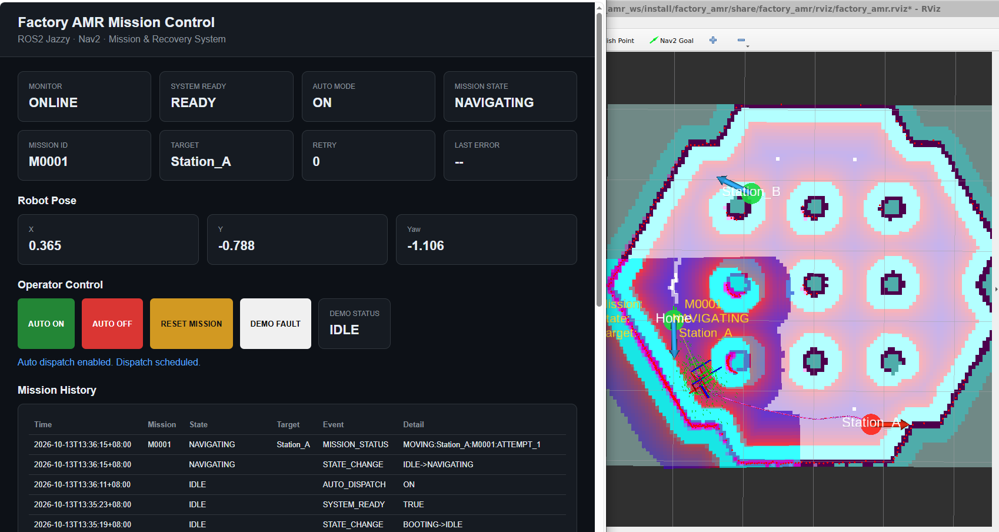
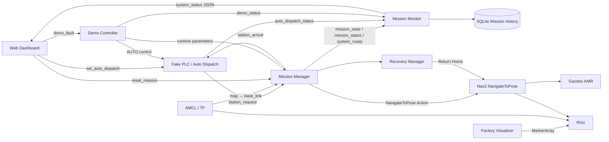
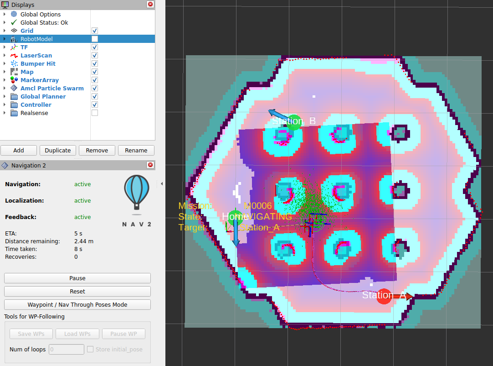
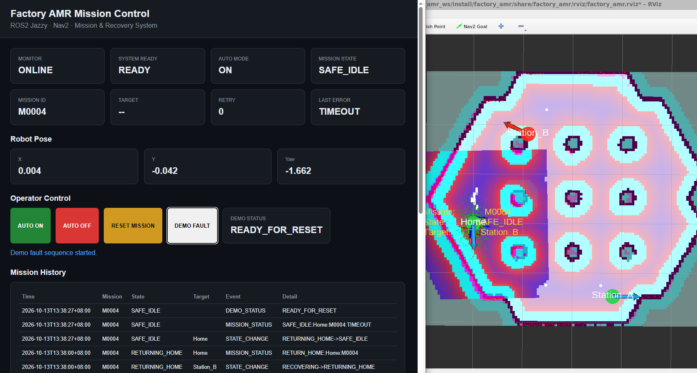
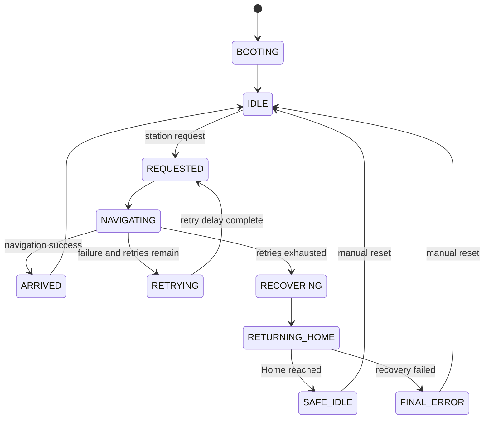

# Factory AMR Mission Control & Recovery System

> ROS 2 Jazzy · Nav2 · AMCL · Gazebo · Mission State Machine · Auto Dispatch · Recovery · Monitoring · Web Dashboard

[中文版](README_zh-TW.md)

## Overview

This project is a factory-oriented AMR mission-control simulation built with ROS 2 Jazzy.

The focus is not only point-to-point navigation. The project models the system behavior expected around a factory AMR workflow:

- simulated PLC dispatch,
- localization / Nav2 readiness interlocks,
- Nav2 Action-based navigation,
- mission state management,
- watchdog timeout and retry,
- Return Home recovery,
- SAFE_IDLE / FINAL_ERROR handling,
- operator reset,
- RViz visualization,
- web dashboard,
- SQLite mission history,
- deterministic one-click fault injection.

## System Overview



The system integrates ROS 2 mission orchestration, simulated PLC auto dispatch,
Nav2 autonomous navigation, runtime monitoring and a web-based operator dashboard.

## V1.0 Status

**Feature Freeze: complete**

Validated in the V1.0 acceptance test:

- one-command launch
- localization / Nav2 readiness handshake
- AUTO ON / OFF
- cyclic station dispatch
- station arrival handling
- navigation timeout
- runtime retry count
- Nav2 goal cancellation
- recovery and Return Home
- SAFE_IDLE / FINAL_ERROR
- manual reset
- demo fault injection
- runtime parameter restore
- mission monitoring
- SQLite mission history
- web dashboard
- custom RViz configuration

## Key Features

### Factory-style mission flow

A simulated PLC publishes station requests only when:

```text
AUTO ON
+ SYSTEM_READY
+ Mission State = IDLE
= Dispatch Allowed
```

AUTO OFF does not cancel an active mission. It prevents the next automatic dispatch.

### Readiness handshake

The system does not rely on a blind startup delay.

`MissionManager` checks:

- `map -> base_link` TF availability
- Nav2 `NavigateToPose` Action server availability

Only after both are ready does `/system_ready` become `true`.

### Runtime navigation control

Navigation is executed through the Nav2 `NavigateToPose` Action interface.

Runtime parameters:

```text
navigation_timeout
max_retries
retry_delay
```

The mission layer provides:

- watchdog timeout
- asynchronous goal cancellation
- configurable retry count
- retry delay
- runtime ROS parameter updates

### Failure recovery

If normal navigation exhausts the configured retries:

```text
Normal Mission Failure
        ↓
    RECOVERING
        ↓
 RETURNING_HOME
        ↓
  ┌─────────────┐
  │             │
success       failure
  │             │
  ▼             ▼
SAFE_IDLE   FINAL_ERROR
```

The robot does not silently resume normal operation after recovery. An operator reset is required.

### One-click fault demo

The dashboard provides a `DEMO FAULT` function for a repeatable portfolio demonstration.

It:

1. saves current runtime mission parameters,
2. pauses AUTO,
3. applies deterministic fault parameters,
4. resumes AUTO,
5. forces a short navigation timeout,
6. demonstrates cancel / recovery / Return Home,
7. restores the original parameters,
8. finishes in `READY_FOR_RESET`.

After `RESET MISSION`, demo status returns to `IDLE`.

High-level demo status:

```text
IDLE
ACTIVE
READY_FOR_RESET
ERROR:<reason>
```

### Monitoring and mission history

`MissionMonitor` consolidates ROS runtime information into:

```text
/factory_amr/system_status
```

Mission events are also written to SQLite:

```text
~/.ros/factory_amr/mission_history.db
```

Tracked information includes:

- mission ID
- mission state
- target
- retry count
- system readiness
- AUTO mode
- event type
- event detail
- robot pose

### Web dashboard

The dashboard provides:

- monitor online/offline
- system ready
- AUTO mode
- mission state
- mission ID
- target
- retry count
- last error
- robot pose
- mission history
- AUTO ON / OFF
- RESET MISSION
- DEMO FAULT
- demo status

Default local endpoint:

```text
http://127.0.0.1:8088
```

## System Architecture



Detailed architecture: [docs/architecture.md](docs/architecture.md)

## Navigation Visualization



RViz visualizes localization, navigation, AMCL particle distribution,
station markers and the active mission target.

## Fault Recovery



After a navigation timeout, the active Nav2 goal is canceled and the system
enters recovery. The robot returns Home and transitions to `SAFE_IDLE`,
requiring operator reset before normal dispatch can resume.

## Mission State Machine



Detailed state description: [docs/state_machine.md](docs/state_machine.md)

## ROS 2 Components

| Component | Role |
|---|---|
| `mission_manager` | Mission state machine, Nav2 Action control, timeout, retry, reset, readiness |
| `recovery_manager.py` | Recovery helper used by MissionManager; not a standalone ROS node |
| `plc_simulator` | Fake PLC, AUTO mode, dispatch interlocks, route sequencing |
| `factory_visualizer` | RViz station markers, headings and mission visualization |
| `mission_monitor` | Consolidated runtime status, TF pose, mission history |
| `demo_controller` | Deterministic portfolio fault-injection workflow |
| `dashboard_bridge` | ROS ↔ HTTP bridge and Flask dashboard API |

## Important ROS Interfaces

### Topics

| Topic | Type | Purpose |
|---|---|---|
| `/station_request` | `std_msgs/String` | Fake PLC requests a target station |
| `/station_arrival` | `std_msgs/String` | MissionManager reports completed station |
| `/mission_status` | `std_msgs/String` | Detailed mission event/status stream |
| `/mission_state` | `std_msgs/String` | High-level mission state |
| `/system_ready` | `std_msgs/Bool` | Localization + Nav2 readiness |
| `/auto_dispatch_status` | `std_msgs/Bool` | Actual AUTO dispatch mode |
| `/demo_status` | `std_msgs/String` | High-level demo state |
| `/factory_amr/system_status` | `std_msgs/String` | Consolidated JSON system status |
| `/factory_amr/markers` | `visualization_msgs/MarkerArray` | Factory visualization for RViz |

### Services

| Service | Type | Purpose |
|---|---|---|
| `/set_auto_dispatch` | `std_srvs/SetBool` | Enable / disable AUTO dispatch |
| `/reset_mission` | `std_srvs/Trigger` | Reset SAFE_IDLE / FINAL_ERROR to IDLE |
| `/demo_fault` | `std_srvs/Trigger` | Start deterministic fault demo |

### Action

| Action | Type | Purpose |
|---|---|---|
| `/navigate_to_pose` | `nav2_msgs/NavigateToPose` | Normal navigation and Return Home |

## Project Structure

```text
factory_amr/
├── factory_amr/
│   ├── mission_manager.py
│   ├── recovery_manager.py
│   ├── mission_state.py
│   ├── plc_simulator.py
│   ├── factory_visualizer.py
│   ├── mission_monitor.py
│   ├── dashboard_server.py
│   ├── demo_controller.py
│   └── __init__.py
├── config/
│   ├── mission.yaml
│   ├── stations.yaml
│   └── nav2_params.yaml
├── launch/
│   └── factory_amr_demo.launch.py
├── maps/
├── rviz/
│   └── factory_amr.rviz
├── web/
│   └── dashboard.html
├── resource/
├── test/
├── package.xml
├── setup.py
└── setup.cfg
```

## Environment

Developed and validated with:

- Ubuntu 24.04
- ROS 2 Jazzy
- Nav2
- AMCL
- Gazebo
- RViz2
- Python 3
- Flask
- SQLite
- WSL2 development environment

This is a simulation-focused portfolio project. It does not claim production deployment on a physical AMR.

## Build

```bash
cd ~/factory_amr_ws

colcon build   --packages-select factory_amr   --symlink-install

source install/setup.bash
```

## Run

```bash
ros2 launch   factory_amr   factory_amr_demo.launch.py
```

Dashboard:

```text
http://127.0.0.1:8088
```

## Design Decisions

### Why Action instead of Service for navigation?

Navigation is long-running and needs feedback, result, cancellation and timeout handling. That maps naturally to ROS 2 Action semantics.

### Why is RecoveryManager separated from MissionManager?

Normal mission execution and recovery have different responsibilities. Recovery is isolated to keep normal navigation logic readable while avoiding an unnecessary extra ROS process.

### Why TRANSIENT_LOCAL QoS for state topics?

Late-joining components such as the monitor or dashboard should receive the most recent state immediately instead of waiting for the next transition.

### Why does AUTO OFF not cancel the current mission?

AUTO controls future dispatch policy. It is intentionally separated from the currently active mission.

### Why SAFE_IDLE instead of returning directly to IDLE?

A recovered robot should not silently re-enter normal automatic operation after a failure. `SAFE_IDLE` creates an explicit operator acknowledgement boundary.

## Validation

The V1.0 release passed the final acceptance test covering clean build, one-click launch, readiness, AUTO mode, retry, timeout cancellation, recovery, Return Home, manual reset, dashboard status, robot pose, mission history and custom RViz.

See [docs/test_acceptance.md](docs/test_acceptance.md).

## Portfolio Assets

- [Architecture](docs/architecture.md)
- [Mission State Machine](docs/state_machine.md)
- [Fault Demo Flow](docs/demo_fault_flow.md)
- [V1.0 Acceptance Test](docs/test_acceptance.md)
- [Screenshot Capture Plan](docs/screenshot_plan.md)
- [90-second Demo Script](docs/demo_video_script_zh-TW.md)
- [Resume Bullets](docs/resume_bullets.md)
- [Interview Guide](docs/interview_guide_zh-TW.md)
- [Project Story](docs/project_story.md)

## Future Work

V1.0 is intentionally feature-frozen.

Potential next learning directions:

- C++ ROS 2
- `ros2_control`
- differential-drive kinematics
- wheel odometry
- IMU integration
- `robot_localization` EKF
- real sensor integration
- hardware abstraction
- controlled real AMR / PLC integration

## License

See the repository `LICENSE` file.
