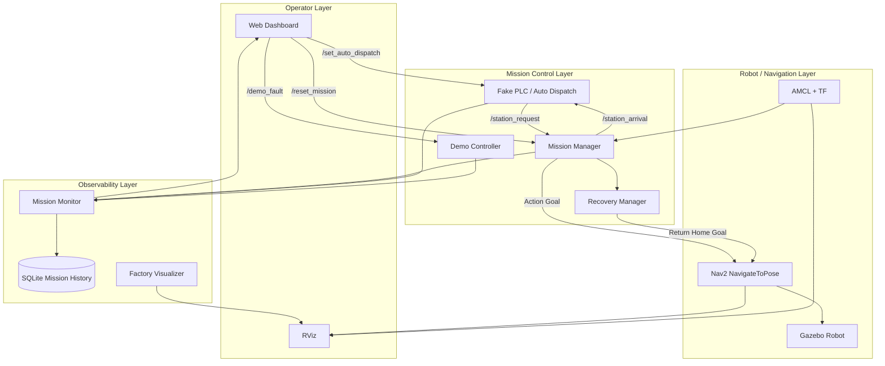

# System Architecture



## Responsibility Boundaries

### MissionManager
- accepts station requests
- validates readiness
- creates mission IDs
- owns normal mission states
- sends Nav2 goals
- starts navigation watchdog
- cancels timed-out goals
- applies retry policy
- exposes reset service

### RecoveryManager
- normal Python helper class, not a ROS node
- owns Return Home recovery flow
- handles recovery delay and timeout
- ends in `SAFE_IDLE` or `FINAL_ERROR`

### PlcSimulator
- fake factory dispatch source
- owns AUTO mode
- dispatches only when AUTO + READY + IDLE
- advances route only after actual arrival
- publishes actual AUTO state

### MissionMonitor
- read-only observability layer
- consolidates mission, AUTO, demo and readiness state
- reads `map -> base_link` pose
- publishes JSON status
- writes SQLite event history

### DemoController
- validates demo preconditions
- saves original runtime parameters
- pauses AUTO
- injects fault parameters
- resumes AUTO
- restores parameters after recovery
- exposes a compact demo state

### DashboardBridge
- serves the dashboard
- provides status/history APIs
- calls ROS control services

## Design Principle

The project deliberately separates:

```text
Robot Mission State
≠
AUTO Dispatch Mode
≠
Demo Mode
```

This prevents unrelated concerns from collapsing into one boolean or one overloaded state machine.
