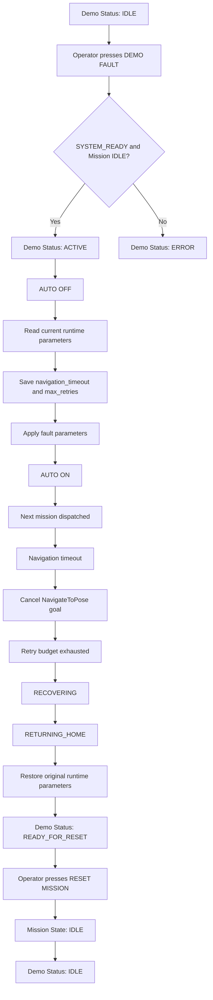

# Demo Fault Flow

## Purpose

The demo function creates a deterministic failure path for a portfolio presentation without permanently changing the normal mission configuration.

## High-Level Demo State

Only four operator-facing states are exposed:

```text
IDLE
ACTIVE
READY_FOR_RESET
ERROR:<reason>
```

## Flow



## Meaning of READY_FOR_RESET

`READY_FOR_RESET` means:

> The failure demonstration is complete, recovery has finished, the original runtime parameters have been restored, and the system is waiting for operator acknowledgement.
