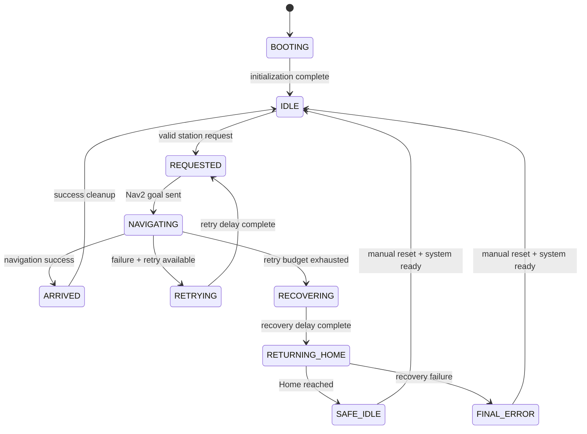

# Mission State Machine



## State Meanings

| State | Meaning |
|---|---|
| `BOOTING` | MissionManager is starting |
| `IDLE` | Ready to accept a new mission |
| `REQUESTED` | Mission accepted and preparing navigation |
| `NAVIGATING` | Nav2 goal is active |
| `ARRIVED` | Target reached successfully |
| `RETRYING` | Normal mission failed but retry budget remains |
| `RECOVERING` | Normal retries are exhausted |
| `RETURNING_HOME` | Recovery navigation is active |
| `SAFE_IDLE` | Recovery succeeded; operator acknowledgement required |
| `FINAL_ERROR` | Recovery failed; manual intervention required |

## Retry Semantics

The initial attempt is not counted as a retry.

```text
ATTEMPT_1 → retry_count = 0
ATTEMPT_2 → retry_count = 1
ATTEMPT_3 → retry_count = 2
```

`retry_count` means the number of retry operations that actually occurred for the current mission, not the configured retry limit.
